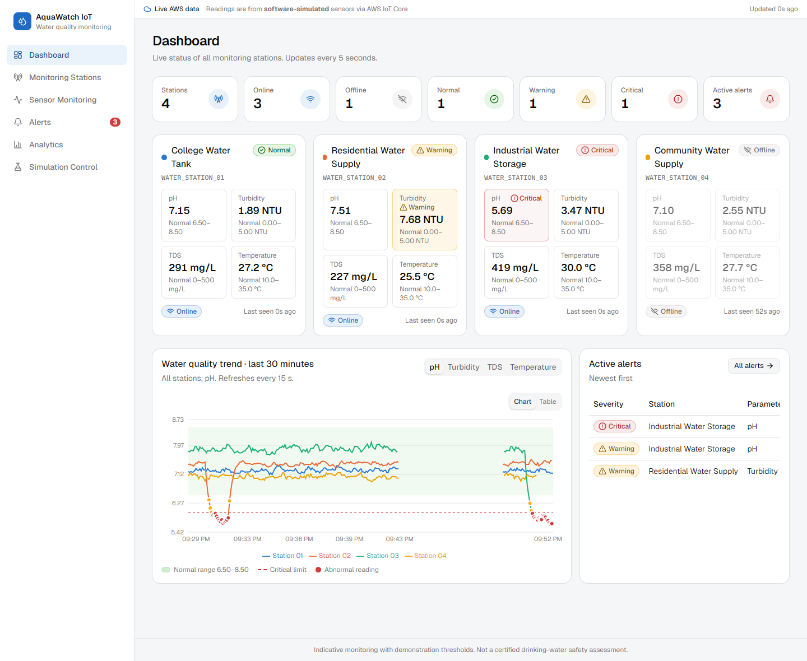
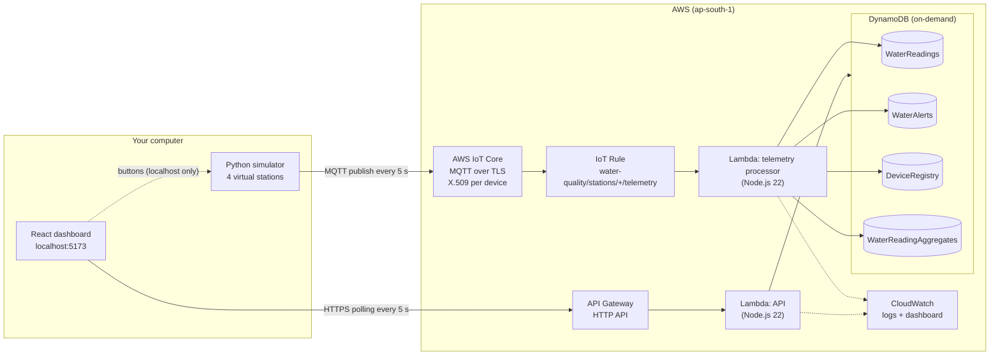
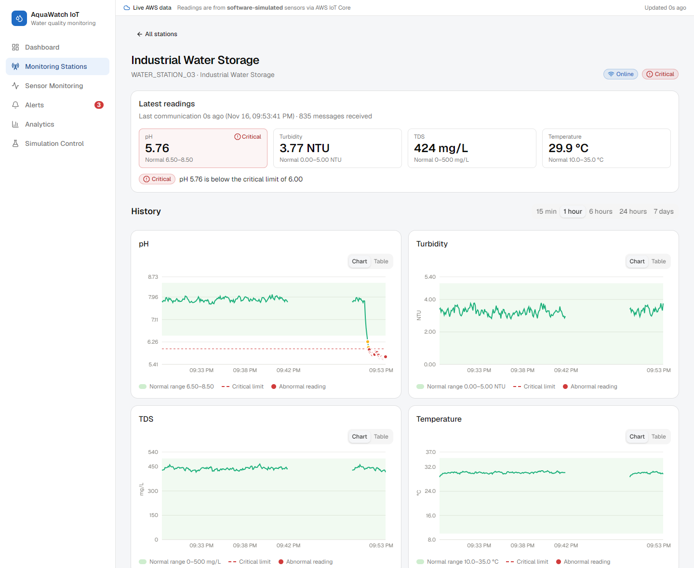
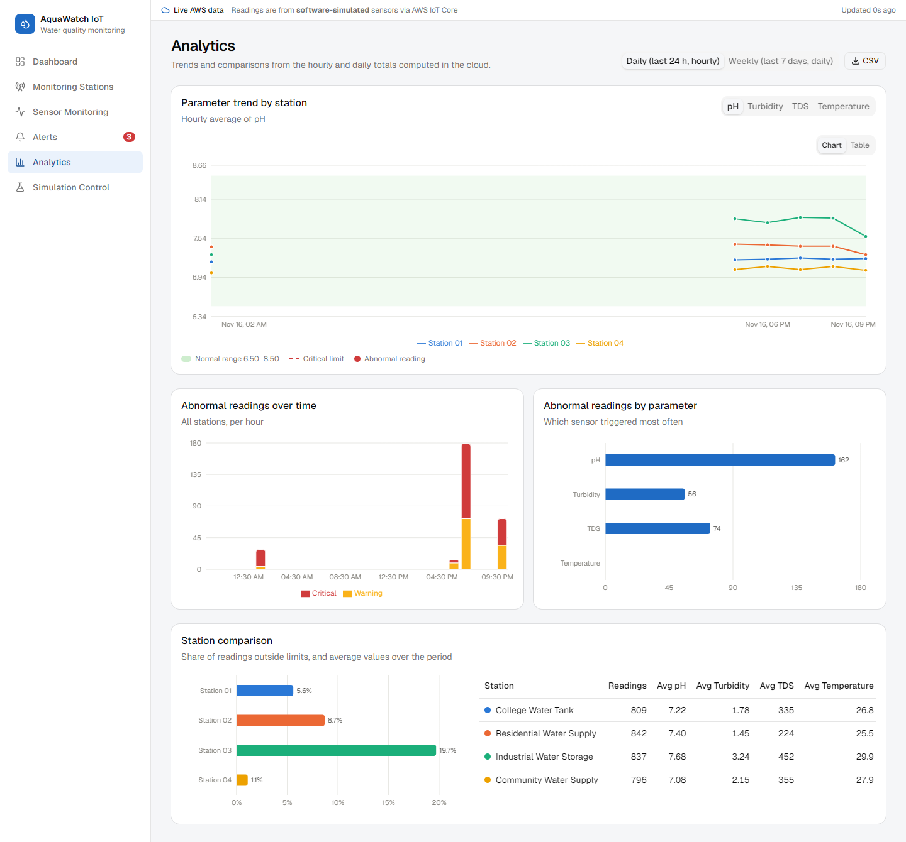
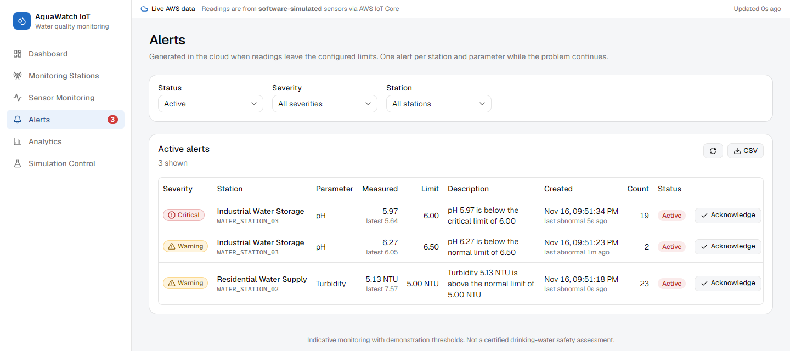
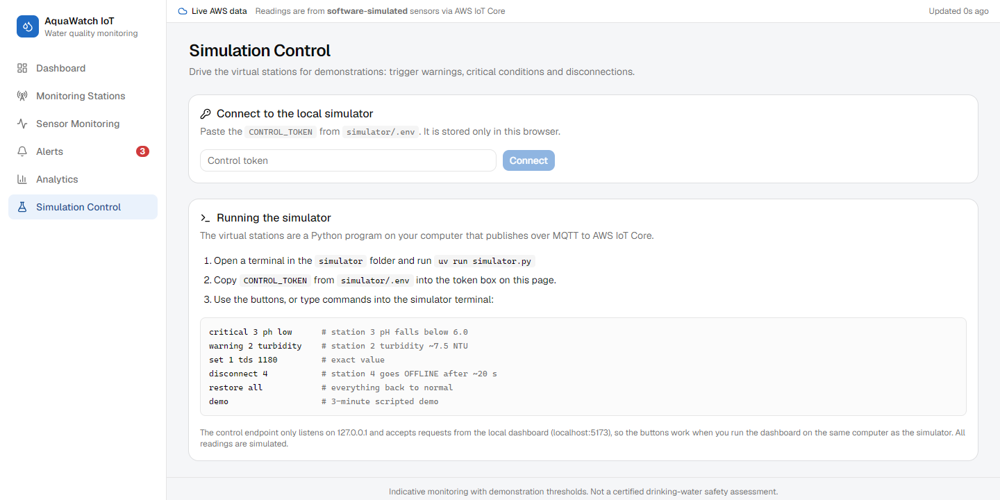

# AquaWatch IoT: AWS-Based Water Quality Monitoring & Contamination Alerts

**Development of an AWS-Based IoT Water Quality Monitoring System with Contamination Detection and Real-Time Alerts**

Four software-simulated monitoring stations send pH, turbidity, TDS and temperature readings to **AWS IoT Core** over real MQTT with TLS. In the cloud, a Lambda function checks each reading against configurable thresholds, stores it in DynamoDB and raises alerts. A React dashboard shows the live state, history, alerts and analytics.

> **Important:** There is no physical hardware. All sensor readings are **simulated** by software and labelled as simulated everywhere. The thresholds are **demonstration values**. This is an indicative monitoring system, **not** a certified drinking-water safety assessment, and it does not identify specific contaminants.



---

## Contents

- [Architecture](#architecture)
- [Features](#features)
- [Technology stack](#technology-stack)
- [Repository layout](#repository-layout)
- [Quick start (stack already deployed)](#quick-start-stack-already-deployed)
- [Full setup from scratch](#full-setup-from-scratch)
- [Using the simulator](#using-the-simulator)
- [Water-quality rules](#water-quality-rules)
- [REST API](#rest-api)
- [Environment variables](#environment-variables)
- [Testing](#testing)
- [Monitoring in the AWS console](#monitoring-in-the-aws-console)
- [Security](#security)
- [Cost](#cost)
- [Cleanup](#cleanup)
- [Troubleshooting](#troubleshooting)
- [More documentation](#more-documentation)

---

## Architecture



**How one reading travels:**
1. The **simulator** publishes a JSON message to `water-quality/stations/{deviceId}/telemetry`. Each station connects with its own X.509 certificate.
2. **IoT Core** checks the certificate and the device policy: a station may only publish to its own topic.
3. The **IoT rule** forwards the message to the **telemetry Lambda**, which:
   - validates it;
   - checks the station is registered;
   - evaluates the thresholds;
   - stores the reading and updates the hourly and daily totals;
   - creates or updates alerts;
   - records the station's last-seen time.
4. The **dashboard** polls **API Gateway**. The **API Lambda** answers with DynamoDB queries.

More detail is in [docs/architecture.md](docs/architecture.md): data model, alert de-duplication and design decisions.

## Features

| Area | What you get |
|---|---|
| **Dashboard** | Station counts (total, online, offline, normal, warning, critical), active alerts, a card per station, a 30-minute trend and the newest alerts |
| **Monitoring stations** | Per station: ID, name, location, connection status, last communication, latest readings and message count, plus a detail page with history charts and recent alerts |
| **Sensor monitoring** | Current and historical values, station and parameter filters, date range (preset or custom), abnormal readings highlighted, CSV export |
| **Water-quality evaluation** | Configurable thresholds in `config/thresholds.json` giving NORMAL / WARNING / CRITICAL, with a message naming the parameter that triggered it |
| **Alerts** | Severity, station, parameter, measured value, limit, description and timestamp. Acknowledge, full history, filters, pagination, CSV. **De-duplicated**: one alert per station and parameter while the problem lasts |
| **Analytics** | Daily (hourly points) and weekly (daily points) trends, station comparison, abnormal readings over time and by parameter, CSV export |
| **Simulation control** | Trigger warning or critical values, set exact values, disconnect or restore stations, run a 3-minute scripted demo, from the terminal or the dashboard buttons |
| **Offline detection** | A station silent for more than 20 seconds is shown as OFFLINE, based on when the cloud last heard from it |
| **Mock mode** | The dashboard also runs without AWS, using generated sample data and showing a clear banner |
| **CloudWatch dashboard** | One AWS console page showing the whole pipeline (IoT, Lambda, DynamoDB, API) plus water-quality charts |

<table>
  <tr>
    <td></td>
    <td></td>
  </tr>
  <tr>
    <td></td>
    <td></td>
  </tr>
</table>

## Technology stack

| Layer | Technology |
|---|---|
| Virtual devices | Python 3.12, [uv](https://docs.astral.sh/uv/), AWS IoT Device SDK v2 for Python (MQTT over TLS, port 8883) |
| Device connectivity | AWS IoT Core: things, X.509 certificates, device policy, IoT rule |
| Processing and API | AWS Lambda (Node.js 22, arm64), AWS SDK v3 (already included in the Lambda runtime) |
| Storage | Amazon DynamoDB, on-demand, with TTL |
| API | Amazon API Gateway HTTP API (CORS, throttling, access logs) |
| Observability | Amazon CloudWatch Logs, metrics and a dashboard; AWS Budgets |
| Infrastructure | Terraform (AWS provider 6.x), AWS CLI, boto3 for the certificate scripts |
| Frontend | React 19, Vite, Tailwind CSS v4, shadcn/ui, Recharts, React Router |
| Tests | pytest (simulator); `node:test` with an in-memory fake DynamoDB, [dynalite](https://github.com/architect/dynalite) (Lambdas) |

## Repository layout

```
├── config/                  shared by everything: stations.json, thresholds.json
├── simulator/               Python virtual stations (single file: simulator.py) + tests
├── backend/                 Lambda functions (Node.js)
│   ├── src/                 telemetry.mjs, api.mjs, evaluation.mjs, shared.mjs
│   └── test/                node:test suites against an in-memory fake DynamoDB
├── frontend/                React dashboard (Vite)
├── infra/terraform/         all AWS resources (iot, lambda, dynamodb, apigateway, iam, cloudwatch, …)
├── scripts/                 provision_certs.py, remove_certs.py, demo-up.ps1, demo-down.ps1
├── certs/                   device certificates and keys (git-ignored, created by the script)
└── docs/                    architecture, AWS setup, demo guide, API reference, screenshots
```

## Quick start (stack already deployed)

If the AWS resources and certificates already exist, you only need two terminals.

```powershell
# Terminal 1: the 4 virtual stations
cd simulator
uv run simulator.py

# Terminal 2: the dashboard
cd frontend
npm run dev          # open http://localhost:5173
```

The top bar should say **Live AWS data**. Type `help` in the simulator terminal for commands. Stop both with **Ctrl+C**; AWS costs nothing while the simulator is stopped.

## Full setup from scratch

### Prerequisites

| Tool | Version used | Check |
|---|---|---|
| AWS CLI v2 with a configured profile | 2.36 | `aws sts get-caller-identity` |
| Terraform | ≥ 1.6 (1.15 used) | `terraform --version` |
| Python + uv | 3.12 / uv 0.8 | `uv --version` |
| Node.js + npm | ≥ 22 (24 used) | `node --version` |

The AWS identity needs permission to create IoT, Lambda, DynamoDB, API Gateway, IAM, CloudWatch and Budgets resources. The step-by-step version, with a console tour, is in [docs/aws-setup.md](docs/aws-setup.md).

### 1. Create the AWS resources

```powershell
cd infra/terraform
copy terraform.tfvars.example terraform.tfvars   # optional: set budget_alert_email
terraform init
terraform plan        # review: about 43 resources, nothing destroyed
terraform apply
```

### 2. Create device certificates

```powershell
cd ../..
uv run scripts/provision_certs.py
```

This creates one certificate and private key per station in `certs/` (git-ignored, readable only by your user) and attaches each to its IoT thing and to the device policy. **Private keys never go into Terraform state or Git.**

### 3. Configure and run the simulator

```powershell
cd simulator
copy .env.example .env      # set IOT_ENDPOINT (terraform output iot_endpoint) and a long random CONTROL_TOKEN
uv sync
uv run simulator.py
```

### 4. Configure and run the dashboard

```powershell
cd frontend
copy .env.example .env.local   # set VITE_API_BASE_URL (terraform output api_url)
npm install
npm run dev                     # http://localhost:5173
```

> **Shortcut:** `.\scripts\demo-up.ps1` does steps 1–2 and writes `IOT_ENDPOINT` and `VITE_API_BASE_URL` into the env files for you.

## Using the simulator

Type commands into the running simulator, or use the **Simulation Control** page. That page asks once for the `CONTROL_TOKEN` from `simulator/.env` and stores it only in your browser.

| Command | Effect |
|---|---|
| `status` | Show all stations |
| `warning 2 turbidity` | Move a parameter into the WARNING band (default parameter: turbidity) |
| `critical 3 ph low` | Move a parameter into the CRITICAL band; `low` goes below the limit instead of above (default: ph) |
| `set 1 tds 1180` | Set an exact value |
| `normal 3` / `normal 3 ph` | Back to normal (all parameters or one) |
| `disconnect 4` | Simulate a sensor or network failure. The dashboard shows OFFLINE after about 20 s |
| `restore all` | Everything normal and online |
| `demo` / `demo stop` | A 3-minute scripted demo: warning, then critical, set value, disconnect, recover |
| `quit` | Disconnect all stations and exit |

Stations can be given as `1`–`4`, a full ID like `WATER_STATION_03`, or `all`.

- **Realistic readings:** values drift smoothly toward a target, with a small daily cycle and noise.
- **Repeatable demos:** the random seed is fixed (`SIM_SEED`), so the same demo replays the same way.
- **Offline testing:** `uv run simulator.py --dry-run` runs without AWS.

Example message:

```json
{
  "schemaVersion": 1,
  "deviceId": "WATER_STATION_01",
  "location": "College Water Tank",
  "timestamp": "2026-11-16T10:00:00.123Z",
  "seq": 42,
  "simulated": true,
  "readings": { "ph": 7.2, "turbidity": 1.8, "tds": 320, "temperature": 26.5 }
}
```

## Water-quality rules

Defined once in [`config/thresholds.json`](config/thresholds.json) and used by the simulator, the Lambdas and the dashboard.

| Parameter | Normal | Warning when | Critical when |
|---|---|---|---|
| pH | 6.5 – 8.5 | outside normal | < 6.0 or > 9.0 |
| Turbidity (NTU) | 0 – 5 | > 5 | > 10 |
| TDS (mg/L) | 0 – 500 | > 500 | > 1000 |
| Temperature (°C) | 10 – 35 | outside normal | < 5 or > 40 |

- **Station status:** CRITICAL if any parameter is critical, otherwise WARNING if any parameter is outside normal, otherwise NORMAL.
- **Alert de-duplication:** while a station and parameter stay abnormal, the **same alert** is updated (occurrence count and latest value). A new alert is created only after **10 minutes** back in the normal range, or when the problem **gets worse** (warning to critical).
- **Messages name the cause**, for example *"pH 5.76 is below the critical limit of 6.00"*.

## REST API

Base URL: the `api_url` Terraform output. All responses are JSON. Full reference with examples: [docs/api.md](docs/api.md).

| Method & path | Purpose | Main query parameters |
|---|---|---|
| `GET /health` | Health check | |
| `GET /config/thresholds` | Thresholds and offline timeout | |
| `GET /dashboard/summary` | Counts, active alerts, all stations | |
| `GET /devices` | All stations with status | |
| `GET /devices/{deviceId}` | One station and its recent alerts | |
| `GET /devices/{deviceId}/readings` | History (paginated) | `from`, `to`, `limit` (1–1000), `order`, `nextToken` |
| `GET /readings/latest` | Latest reading per station | |
| `GET /alerts` | Alerts (paginated) | `status`, `severity`, `deviceId`, `from`, `to`, `limit`, `nextToken` |
| `PATCH /alerts/{alertId}/acknowledge` | Acknowledge an alert | body: `acknowledgedBy`, `note` (optional) |
| `GET /analytics/trends` | Hourly or daily averages and abnormal counts | `granularity` (`hour`/`day`), `from`, `to`, `deviceId` |

Errors use proper status codes: `400` for invalid input, `404` for not found, `409` for an alert that's already acknowledged, and `500` with a generic message that exposes no internal details.

## Environment variables

**`simulator/.env`** (copy from `.env.example`, never commit)

| Variable | Meaning |
|---|---|
| `IOT_ENDPOINT` | AWS IoT data endpoint (`terraform output iot_endpoint`) |
| `CERTS_DIR` | Certificate folder, default `../certs` |
| `PUBLISH_INTERVAL` | Seconds between readings (default 5) |
| `SIM_SEED` | Random seed for repeatable demos |
| `CONTROL_PORT` / `CONTROL_TOKEN` | Local control endpoint for the dashboard buttons (127.0.0.1 only) |

**`frontend/.env.local`** (copy from `.env.example`, git-ignored)

| Variable | Meaning |
|---|---|
| `VITE_API_BASE_URL` | API Gateway URL (`terraform output api_url`). Empty means mock mode |
| `VITE_DATA_MODE` | `live` (default) or `mock` |
| `VITE_SIM_CONTROL_URL` | Local simulator control endpoint, default `http://127.0.0.1:8765` |

Never put secrets in `VITE_*` variables, because they are built into the website's JavaScript. The build refuses to run if `VITE_SIM_CONTROL_TOKEN` is set.

**`infra/terraform/terraform.tfvars`** (git-ignored): `budget_alert_email`, plus optional overrides of the values in `variables.tf` (region, CORS origins, retention, thresholds for offline and cooldown).

## Testing

```powershell
cd simulator; uv run pytest      # 26 tests: readings, commands, message format, control endpoint
cd backend;   npm install; npm test   # 38 tests: validation, evaluation, storage, alerts, every API route
cd frontend;  npm run build; npm run lint
```

The backend tests run against **dynalite**, an in-memory fake DynamoDB with the same tables and indexes as Terraform creates. No AWS account, Docker or Java is needed.

**End-to-end checks run against the real AWS stack:**
1. Four devices connected over mTLS, and AWS confirmed every message.
2. Every reading was stored and the hourly and daily totals updated.
3. A critical trigger created a real alert without duplicates.
4. Acknowledge returned 200, and a second acknowledge returned 409.
5. A disconnected station showed OFFLINE after about 19 s and came back ONLINE after about 6 s.
6. The dashboard showed all of the above.
7. 3,060 rule-to-Lambda handoffs with 0 failures.

## Monitoring in the AWS console

All resources are in **ap-south-1 (Mumbai)** and named `wq-dev-*`.

- **CloudWatch dashboard `wq-dev-water-quality`** (`terraform output dashboard_url`): water-quality charts, latest alerts, IoT, Lambda, DynamoDB and API metrics, and rejected messages, on one page.
- **IoT Core → MQTT test client**: subscribe to `water-quality/stations/+/telemetry` to watch messages arrive live.
- **DynamoDB → Tables → Explore items**: the stored readings and alerts.

A full console tour is in [docs/aws-setup.md](docs/aws-setup.md#5-see-it-in-the-aws-console).

## Security

**Devices:**
- Each device authenticates with its **own X.509 certificate**.
- The IoT policy only lets a device connect with its own thing name and publish to **its own topic**.
- Private keys stay in `certs/`, which is git-ignored and readable only by the current user. They never go into Terraform state or outputs.

**Cloud:**
- **Least-privilege IAM:** each Lambda and the IoT rule can only reach the exact tables and log groups they use.
- **Validation:** incoming telemetry is checked (device ID format, topic match, timestamps, numeric ranges) and API input is checked too.
- **API protection:** CORS is limited to the local dashboard origin, and API Gateway throttling (20 requests/s, burst 40) caps traffic and cost.

**Simulator control endpoint:**
- It listens on **127.0.0.1 only** and requires a bearer token.
- It is never exposed to the internet, and the token is never built into the website.

**Never committed:** `.env` files, certificates and keys, Terraform state, `terraform.tfvars`.

**Known limitation (demo scope):** the API has no login. Anyone with the URL can read the simulated data and acknowledge alerts, and `acknowledgedBy` is a label, not a verified identity. For real use, add a Cognito JWT authorizer.

## Cost

**Everything is pay-per-use, with nothing always on:** no EC2, NAT gateway, RDS or Kubernetes.

| Situation | Approximate cost |
|---|---|
| Idle (stack deployed, simulator off) | ~$0 |
| 1 hour of demo (4 stations plus the dashboard) | ~$0.03–0.05 |
| Simulator running 24/7 for a month | ~$8–10 |

**Built-in cost controls:**
- readings expire after 14 days and hourly totals after 90;
- logs are kept for 7 days;
- API throttling caps traffic;
- the CloudWatch dashboard uses free metrics plus cheap log queries;
- a **$5/month AWS Budgets alert** that counts real usage, even while credits pay for it.

## Cleanup

```powershell
.\scripts\demo-down.ps1
```

This removes the certificates first (AWS won't delete a thing with an attached certificate) and then runs `terraform destroy`. You must type `DELETE` to confirm. **All stored readings and alerts are deleted.** Run `.\scripts\demo-up.ps1` to rebuild everything later.

To do it by hand: `uv run scripts/remove_certs.py --yes`, then `terraform -chdir=infra/terraform destroy`.

## Troubleshooting

| Symptom | Fix |
|---|---|
| Simulator says *missing certificate* | Run `uv run scripts/provision_certs.py` from the repo root |
| Dashboard shows *Mock data mode* | Set `VITE_API_BASE_URL` in `frontend/.env.local` and restart `npm run dev` |
| Dashboard shows *API unreachable* | Check the URL with `terraform output api_url`, and make sure the dashboard runs on port 5173 (the CORS origin) |
| Simulation page says *simulator not running* | Start `uv run simulator.py` on the same computer |
| Simulation page says *wrong token* | Paste the `CONTROL_TOKEN` value from `simulator/.env` |
| A station flickers between online and offline | Your PC clock doesn't matter (online status uses cloud time). Check the simulator is still publishing |

## More documentation

- [docs/architecture.md](docs/architecture.md): components, data model, alert logic, design decisions
- [docs/aws-setup.md](docs/aws-setup.md): AWS account setup, Terraform, certificates, console tour, teardown
- [docs/demo-guide.md](docs/demo-guide.md): a step-by-step presentation script
- [docs/api.md](docs/api.md): API reference with examples
- [docs/PROGRESS.md](docs/PROGRESS.md): milestone checklist
