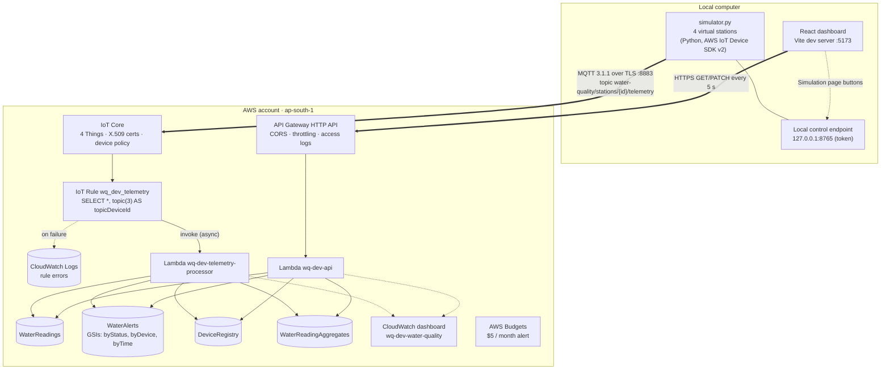
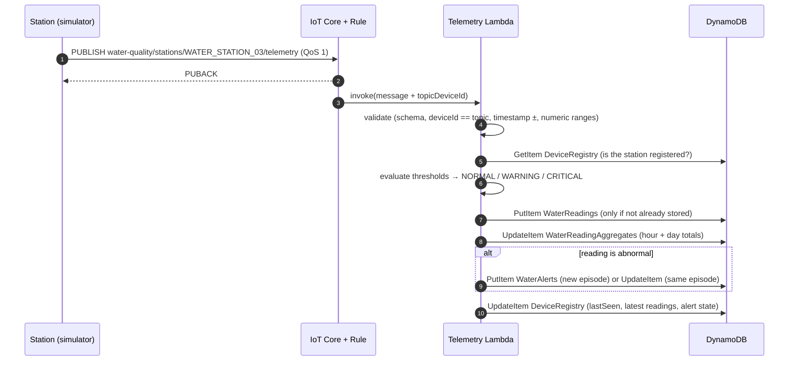
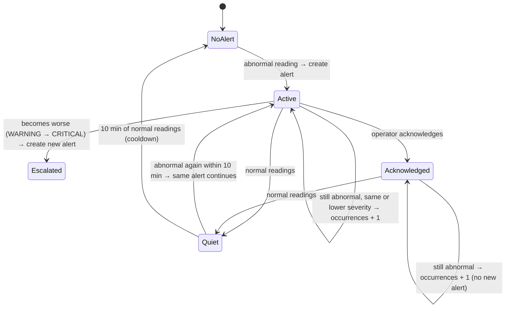

# Architecture

## Overview

## Components

| Component | Responsibility | Code |
|---|---|---|
| **Simulator** | Generates realistic readings for 4 stations and publishes them every 5 s with QoS 1, one MQTT connection and certificate per station. Takes commands from the terminal or the local control endpoint | `simulator/simulator.py` |
| **IoT Core** | Authenticates each device by certificate and enforces the device policy | `infra/terraform/iot.tf` |
| **IoT rule** | Matches `water-quality/stations/+/telemetry`, adds `topicDeviceId` taken from the topic, and invokes the telemetry Lambda. Failures go to a log group | `iot.tf` |
| **Telemetry Lambda** | Validate, evaluate, store, aggregate, raise alerts, update the station | `backend/src/telemetry.mjs` |
| **API Lambda** | 10 REST routes for the dashboard, using DynamoDB `Query` (no table scans except the 4-row registry) | `backend/src/api.mjs` |
| **Evaluation** | Threshold rules shared by both Lambdas | `backend/src/evaluation.mjs`, `config/thresholds.json` |
| **Dashboard** | 6 pages; polls the API every 5 s and pauses while the tab is hidden | `frontend/src` |

## Telemetry processing

**Validation** rejects:
- a missing or malformed `deviceId`;
- a `deviceId` that doesn't match the MQTT topic;
- a missing timestamp, or one without a timezone, more than 5 minutes in the future, or more than 24 hours old;
- a missing or non-numeric reading, or one outside its physically valid range (for example pH outside 0–14).

Rejected messages are logged and dropped. They are never stored.

**Idempotency:** a reading is written with `attribute_not_exists`, so a message delivered twice (MQTT QoS 1) is stored once. A late, out-of-order message is kept in history but does not overwrite the station's latest state.

## Data model

| Table | Key | Indexes | Purpose |
|---|---|---|---|
| `WaterReadings` | `deviceId` (PK), `timestamp` (SK) | – | Every reading; TTL 14 days |
| `WaterAlerts` | `alertId` (PK) | `byStatus` (status, createdAt), `byDevice` (deviceId, createdAt), `byTime` (entity, createdAt) | Alerts and their history |
| `DeviceRegistry` | `deviceId` (PK) | – | Name, location, `lastSeen`, latest readings and status, alert state |
| `WaterReadingAggregates` | `seriesKey` (PK, e.g. `WATER_STATION_01#HOUR`), `bucket` (SK, e.g. `2026-11-16T10`) | – | Hourly and daily count, sums and abnormal counts; hourly rows expire after 90 days |

**Why the aggregates table:** a weekly chart of raw readings would read about 120,000 items per station. The aggregates are updated as each reading arrives, with an atomic `ADD`, so a weekly chart reads about 170 small rows instead. The dashboard uses raw readings for ranges up to 6 hours and aggregates beyond that.

All timestamps are ISO-8601 UTC with milliseconds (`2026-11-16T10:00:00.123Z`), so string order equals time order.

## Alert de-duplication

Each station keeps a small `alertState` per parameter (`alertId`, `severity`, `lastAbnormalAt`) in `DeviceRegistry`. This gives one alert per station and parameter per episode instead of one every 5 seconds.

## Online and offline detection

`lastSeen` is the time **the cloud received** a message, not the device's own timestamp. In testing, the host clock ran 15.8 s behind AWS, which made stations flicker offline. A station is **ONLINE** if `now − lastSeen ≤ 20 s` (4 missed readings at 5 s), otherwise **OFFLINE**, or **NEVER_SEEN** if it has never reported. This is worked out when the API is called, so no scheduled job is needed.

## Design decisions

| Decision | Reason |
|---|---|
| Certificates created by a script, not Terraform | Keeps private keys out of Terraform state and outputs |
| Simulator in Python, Lambdas in Node.js | The spec asked for a Python device SDK. The cloud code and the dashboard share one language, which is easier to explain and maintain |
| HTTP API instead of REST API | Cheaper and simpler. CORS and throttling are built in |
| Polling every 5 s instead of WebSockets | Meets the spec and is simpler. The UI pauses polling while the tab is hidden |
| Single code zip, no bundled dependencies | AWS SDK v3 is already in the Lambda runtime, so the zip contains only our files and `thresholds.json` |
| arm64 Lambdas, on-demand DynamoDB, TTL, 7-day logs | Lowest cost for occasional demo use |
| Control endpoint on 127.0.0.1 with a token | Demo controls without exposing anything to the internet |
| Logs Insights widgets instead of custom metrics | Charts water quality in CloudWatch for fractions of a cent instead of ~$5/month in custom metrics |
