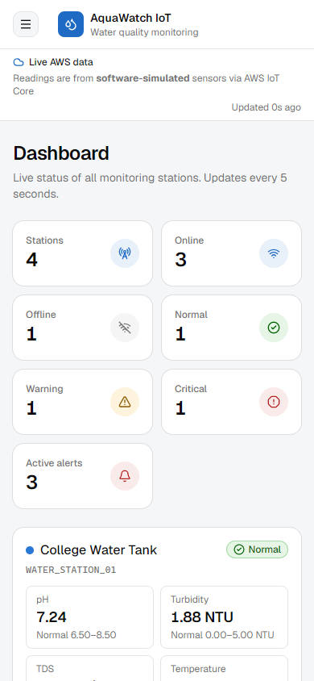

# Demo Guide

A repeatable script for presenting the project, about 10–12 minutes.

## Before the presentation (15 minutes ahead)

1. **Start the stations** so the charts have history:
   ```powershell
   cd simulator
   uv run simulator.py --quiet
   ```
   All 4 should print `connected to AWS IoT Core`.
2. **Start the dashboard:**
   ```powershell
   cd frontend
   npm run dev        # http://localhost:5173
   ```
3. On the **Simulation Control** page, paste the `CONTROL_TOKEN` from `simulator/.env` once.
4. Open these browser tabs:
   - the dashboard;
   - **AWS IoT → MQTT test client**, subscribed to `water-quality/stations/+/telemetry`;
   - **CloudWatch → Dashboards → `wq-dev-water-quality`**;
   - **DynamoDB → `wq-dev-WaterAlerts` → Explore items**.
5. Optional: on the **Alerts** page, acknowledge leftover alerts from earlier runs so the list starts empty.

## The script

| Time | Do | Say |
|---|---|---|
| 0:00 | Show the README architecture diagram | "Four software-simulated stations send pH, turbidity, TDS and temperature to AWS IoT Core over real MQTT with TLS. Each station has its own X.509 certificate." |
| 1:00 | **MQTT test client** tab | "These are the actual messages arriving in AWS, one per station every 5 seconds. The IoT policy only lets each station publish to its own topic." |
| 2:00 | **Dashboard** | "An IoT rule triggers a Lambda that validates and evaluates every reading and stores it in DynamoDB. The dashboard reads it through API Gateway every 5 seconds. All 4 stations are online and normal." |
| 3:00 | **Simulation Control** → station 2 → Turbidity → **Warning** (or type `warning 2 turbidity`) | "I'll simulate cloudy water at the residential supply. Values change gradually, like a real sensor." |
| 3:30 | **Dashboard** | Turbidity crosses 5 NTU: the station turns **Warning**, an alert appears, and the sidebar badge counts it. |
| 4:30 | **Simulation Control** → station 3 → pH → Too low → **Critical** (`critical 3 ph low`) | "Now an acid contamination at the industrial storage." |
| 5:00 | **Station detail** for station 3 | The chart crosses the dashed critical line with red points. "The message names exactly which parameter and which limit." |
| 6:00 | **DynamoDB → WaterAlerts** (refresh) | "These alerts are real records in the cloud. Notice there's one alert per station and parameter, not one every 5 seconds. Its occurrence count keeps rising instead." |
| 7:00 | **Alerts** page → **Acknowledge** | "An operator acknowledges it. It won't come back as a new alert while the same problem continues." |
| 7:30 | **Disconnect** station 4 (`disconnect 4`) | "Now station 4 loses its connection." About 20 s later it shows **Offline** on the dashboard. |
| 8:30 | **CloudWatch dashboard** | "This is the AWS side: messages per minute, Lambda invocations and errors, DynamoDB writes, API latency, and the alerts from the logs." |
| 9:30 | **Analytics** | "Hourly and daily trends come from totals the Lambda keeps up to date, so a week of data loads in milliseconds. Here's the station comparison and which sensor triggered most often. Everything exports to CSV." |
| 10:30 | **Restore all** | "Everything is back to normal, and stations reconnect automatically." |
| 11:00 | Wrap up | "No servers run continuously: Lambda, DynamoDB on-demand and IoT Core are all pay-per-use, so the stack costs about nothing when idle. Everything is defined in Terraform, and the readings are clearly marked as simulated." |

Shortcut: type `demo` in the simulator terminal for an automatic 3-minute sequence: warning, then critical, set value, disconnect, recover.

## Scenarios

| Scenario | Command | Expected result |
|---|---|---|
| Normal | `restore all` | All stations NORMAL, no new alerts |
| Warning | `warning 2 turbidity` | Station 2 WARNING, turbidity about 7.5 NTU, 1 alert |
| Critical (high) | `critical 1 tds` | TDS about 1250 mg/L. One WARNING alert while passing 500, then one CRITICAL above 1000 |
| Critical (low) | `critical 3 ph low` | pH about 5.75. WARNING below 6.5, then CRITICAL below 6.0 |
| Exact value | `set 4 temperature 41` | Temperature CRITICAL (> 40 °C) |
| Disconnection | `disconnect 4` | OFFLINE after about 20 s; `restore 4` brings it back within about 6 s |
| Full demo | `demo` | A 3-minute scripted sequence; same readings every run (fixed seed) |

## Talking points for questions

- **Is the data real?** No. The sensors are simulated in software. The MQTT connection, certificates, cloud processing and storage are all real AWS.
- **Is the water safe?** The system flags readings outside **demonstration** thresholds. It is not a certified safety assessment and does not identify contaminants.
- **How do you avoid alert spam?** One alert per station and parameter per episode, updated in place. A new one is created only after 10 minutes back in range, or when the problem escalates.
- **What if a message arrives twice or late?** Duplicates are stored once (conditional write). Late messages go into history without overwriting the latest state.
- **How is it secured?** Per-device certificates, a policy limiting each device to its own topic, least-privilege IAM, input validation, CORS and throttling. The simulator controls only listen on localhost.
- **What does it cost?** About $0 idle and a few cents per demo hour. A $5/month budget alert is in place.

## Phone view

The dashboard also works on a phone.



## After the presentation

Press **Ctrl+C** in both terminals. Nothing needs to be destroyed between demos. When the project is finished for good, run `.\scripts\demo-down.ps1`.
